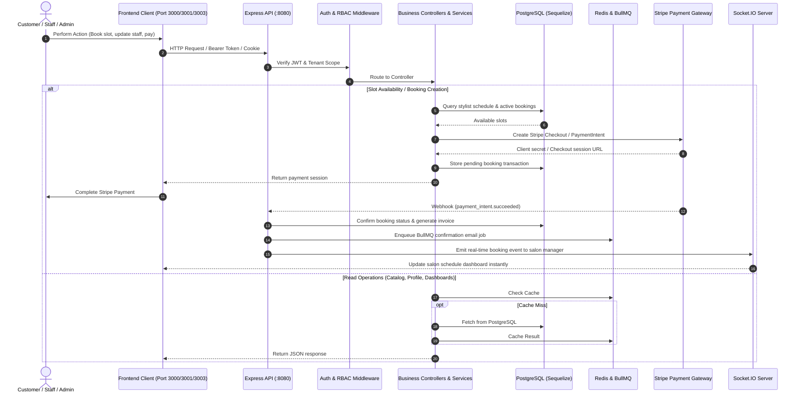

# ZenMonk Salon Management Service (`salon-management-service`)

A robust, enterprise-grade multi-tenant backend REST API and real-time event orchestration engine powering the ZenMonk Salon ecosystem (Public storefront, Salon Management Portal, Super Admin Dashboard, and Marketing integrations).

---

## 1. Problem Statement

Salon management operations are fragmented across appointment scheduling, multi-stylist calendars, customer communication, inventory tracking, and payment processing:
- **Salon Owners & Managers** struggle to coordinate real-time staff schedules, service availability, tiered service pricing, inventory consumption, and Stripe payouts in one unified hub.
- **Customers** need an instant, friction-free way to explore salons, book stylists, select customized service slots, and pay securely online.
- **Platform Super Administrators** lack visibility over multi-tenant subscriptions, subscription plans, and platform-wide onboarding metrics.

**`salon-management-service`** solves this by delivering a centralized, scalable backend handling multi-tenant authorization, appointment lifecycle state machines, payment gateway processing (Stripe & Stripe Connect), automated transactional emails, Redis-backed queues/caching, and real-time Socket.IO events.

---

## 2. High-Level Functional Architecture & Request Flow



---

## 3. Tech Stack

- **Runtime:** Node.js (>= 18.x)
- **Framework:** Express 5.x
- **Database & ORM:** PostgreSQL + Sequelize ORM (`sequelize-cli` migrations & seeders)
- **Caching & Queues:** Redis (`ioredis`), BullMQ, `node-cron`
- **Real-time:** Socket.IO
- **Payments:** Stripe & Stripe Connect API
- **Media Storage:** Cloudinary & Multer
- **Email Engine:** Nodemailer & React Email

---

## 4. Setup & Running the Application

### Prerequisites
- Node.js (v18+ or v20+) and npm (for local runs)
- Docker & Docker Compose (for Docker runs and backing services)
- Shared Docker external network (required for Docker setups):
  ```bash
  docker network create salon_management_shared_network 2>/dev/null || true
  ```

### Environment Configuration
Copy the sample environment file:
```bash
cp .env.example .env
```
Key configuration settings:
- `APP_PORT=8080`: Backend server port
- `DB_HOST`: Set to `localhost` (when running locally) or `salon-management-database` (when running inside Docker network)
- `DB_PORT`: `5432` (or `5433` if exposed externally on host)
- `DB_USER=postgres`, `DB_PASSWORD=admin@zm`, `DB_DATABASE=salon_management_db`
- `REDIS_HOST`: Set to `localhost` (when running locally) or `salon-management-redis` (when running inside Docker network)
- `JWT_SECRET`: Secret key for JWT signing

---

### Running with Docker

#### A. Development Mode (Hot-Reload with Mounted Volume)
The included `docker-compose.yml` mounts the repository and runs `dependency-base` with interactive terminal support:

```bash
# 1. Start database, redis, pgadmin, and backend containers
docker compose up -d

# 2. Run database migrations & seeders inside the container
docker compose exec backend npx sequelize-cli db:migrate
docker compose exec backend npx sequelize-cli db:seed:all

# 3. Start development server inside container with live reload
docker compose exec backend npm run dev

# (Alternatively, run interactive shell)
docker compose exec backend sh
```

#### B. Production Mode (Optimized Production Docker Image)
To build and run an immutable production image:

```bash
# 1. Build production image targeting the production stage
docker build --target production -t salon-management-service:prod .

# 2. Run the production container connected to the shared network
docker run -d \
  --name salon-management-backend-prod \
  --network salon_management_shared_network \
  -p 8080:8080 \
  --env-file .env \
  salon-management-service:prod

# 3. View production container logs
docker logs -f salon-management-backend-prod

# 4. Stop and remove container when done
docker stop salon-management-backend-prod && docker rm salon-management-backend-prod
```

---

### Running Locally on Host Machine

#### A. Development Mode
1. **Start backing services (PostgreSQL & Redis) in Docker:**
   ```bash
   docker compose up -d database redis pgadmin
   ```

2. **Install dependencies:**
   ```bash
   npm install
   ```

3. **Run database migrations & seed default data:**
   ```bash
   npm run up       # Runs Sequelize migrations
   npm run seed     # Seeds initial platform data & super-admin user
   ```

4. **Start the API in development mode (hot-reloading via Nodemon):**
   ```bash
   npm run dev
   ```

5. *(Optional)* **Run React Email template preview:**
   ```bash
   npm run email:dev
   ```

#### B. Production Mode
```bash
npm ci --omit=dev
npm start
```

The API service is accessible on `http://localhost:8080`.
